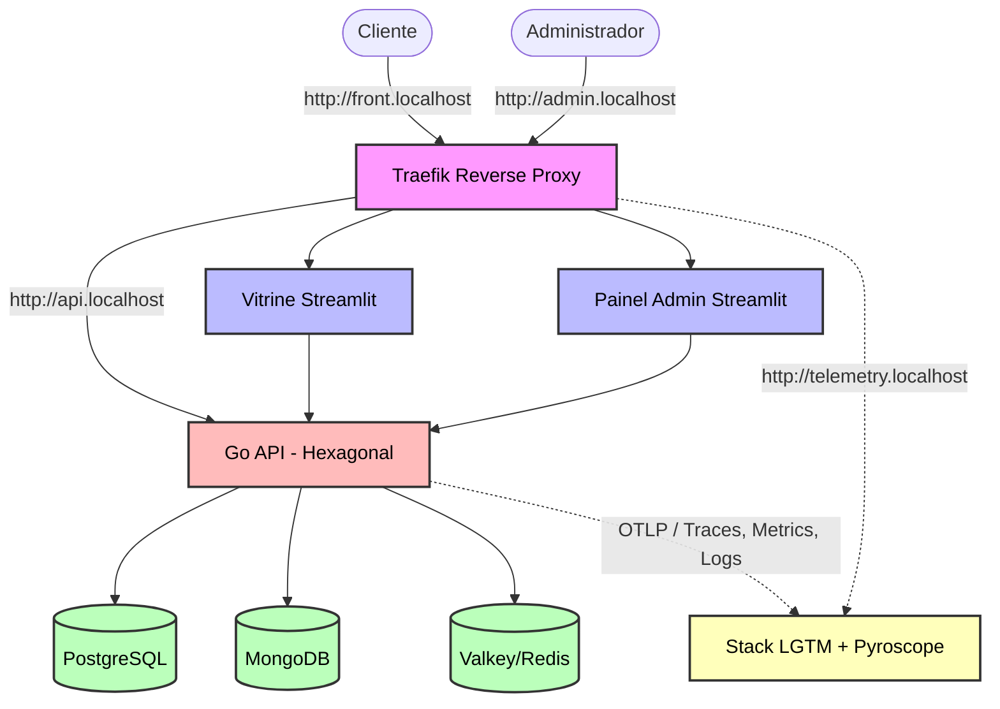

# BazaarGo

<!--toc:start-->
- [BazaarGo](#bazaargo)
  - [Visão geral](#visão-geral)
  - [Diferenciais do projeto](#diferenciais-do-projeto)
  - [Stack de tecnologias](#stack-de-tecnologias)
  - [Arquitetura](#arquitetura)
    - [Estrutura do projeto](#estrutura-do-projeto)
  - [Banco de dados (Persistência Poliglota)](#banco-de-dados-persistência-poliglota)
    - [SGBDs Utilizados](#sgbds-utilizados)
    - [Modelagem de Dados](#modelagem-de-dados)
  - [Endpoints da API](#endpoints-da-api)
    - [Infraestrutura & Autenticação](#infraestrutura--autenticação)
    - [Catálogo de Produtos](#catálogo-de-produtos)
    - [Checkout](#checkout)
  - [Como executar](#como-executar)
    - [Requisitos](#requisitos)
    - [Passos](#passos)
  - [Decisões de projeto](#decisões-de-projeto)
    - [Arquitetura Hexagonal](#arquitetura-hexagonal)
    - [Spec-First com OpenAPI](#spec-first-com-openapi)
    - [Observabilidade de Nível de Produção](#observabilidade-de-nível-de-produção)
    - [Roteamento com Traefik](#roteamento-com-traefik)
    - [Integração com WhatsApp](#integração-com-whatsapp)
  - [Performance e Resiliência](#performance-e-resiliência)
  - [Licença](#licença)
<!--toc:end-->

E-commerce Fullstack (Catálogo de Produtos) com arquitetura hexagonal, persistência poliglota, roteamento inteligente e observabilidade distribuída.

---

## Visão geral

O **BazaarGo** é uma plataforma de e-commerce que permite o cadastro e a listagem de produtos, gerenciamento de carrinho de compras e finalização de pedidos via WhatsApp. O projeto foi construído para demonstrar, na prática, a aplicação do conceito de **Banco de Dados Poliglota** (utilizando a tecnologia certa para cada tipo de dado) aliado a uma arquitetura backend moderna, altamente observável e orquestrada com microsserviços leves.

O sistema atende a dois módulos principais:

1. **Módulo Administrativo:** Onde administradores autenticados (via PostgreSQL) cadastram e gerenciam o catálogo de produtos (MongoDB).
2. **Módulo Cliente:** Uma vitrine que exibe os produtos, registra o histórico de "vistos recentemente" (Valkey) e permite fechar o pedido gerando uma mensagem formatada para o WhatsApp.

> **Nota de transparência:** Este projeto utilizou ferramentas de Inteligência Artificial (IA) como assistente de desenvolvimento durante todo o processo. A IA foi utilizada para acelerar a construção das interfaces visuais, mas também atuou diretamente como um "copiloto" técnico: auxiliando na configuração da infraestrutura (Docker, Traefik, stack LGTM), instrumentação da observabilidade (OpenTelemetry), resolução de bugs complexos e na discussão de tomadas de decisão sobre padrões de projeto e arquitetura. Apesar do forte auxílio da IA, a implementação, os testes e a compreensão de cada decisão técnica foram de responsabilidade do desenvolvedor.

---

## Diferenciais do projeto

Além dos requisitos mínimos, o projeto foi construído seguindo práticas adotadas em ambientes de produção corporativos:

- **Persistência Poliglota:** Uso de PostgreSQL (Autenticação/ACID), MongoDB (Catálogo/Flexibilidade de Schema) e Valkey/Redis (Cache e Histórico de visualizações).
- **Observabilidade Completa (LGTM + Pyroscope):** Rastreamento distribuído (Tempo), agregação de logs estruturados (Loki), coleta de métricas (Prometheus/Mimir) e profiling contínuo de CPU/Memória (Pyroscope).
- **Arquitetura Hexagonal (Ports and Adapters):** Domínio puro e isolado de frameworks, bancos de dados e detalhes de HTTP.
- **Spec-First com OpenAPI (`oapi-codegen`):** A API é gerada a partir do contrato `openapi.yaml`, garantindo *Strict Server* (tipagem forte e validação automática de requests/responses).
- **Reverse Proxy com Traefik:** Roteamento inteligente e isolamento de rede (subdomínios locais como `api.localhost` e `admin.localhost`).
- **Autenticação com PASETO v4:** Substituindo o JWT por um padrão mais seguro contra ataques de análise de tempo e confusão de algoritmos.
- **Hash de senha com Argon2id:** Configurado com parâmetros acima das recomendações mínimas do OWASP.
- **Infraestrutura 100% Containerizada:** Orquestração completa via Docker Compose.

---

## Stack de tecnologias

| Camada | Tecnologia |
| --- | --- |
| **Backend** | |
| Linguagem | Go (Golang) |
| Roteador HTTP | chi |
| Design de API | OpenAPI 3.0 (Spec-First + Strict Server) |
| Autenticação | PASETO v4 |
| Hash de senha | Argon2id |
| **Bancos de Dados** | |
| Relacional (Auth) | PostgreSQL 18 |
| Documentos (Produtos) | MongoDB 9 |
| Cache/Listas (Histórico) | Valkey 9 (Redis) |
| **Observabilidade** | |
| Coleta e Visualização | Grafana, Tempo, Loki, Prometheus, Pyroscope |
| Instrumentação | OpenTelemetry (SDK Go + OTLP gRPC/HTTP) |
| **Frontend & UI** | |
| Vitrine e Painel Admin | Python + Streamlit |
| **Infraestrutura** | |
| Proxy Reverso | Traefik v3 |
| Containerização | Docker e Docker Compose |

---

## Arquitetura

O projeto adota uma arquitetura de microsserviços desacoplados, orquestrada pelo Traefik. O backend segue os princípios da **Arquitetura Hexagonal** e os frontends atuam como consumidores puros da API REST.



### Estrutura do projeto

```
BazaarGo/
├── cmd/
│   └── api/                 # Entrypoint da aplicação (Go)
├── internal/
│   ├── domain/              # Entidades (User, Product) e regras puras
│   ├── ports/               # Interfaces (Repositories, Cache, Auth)
│   ├── service/             # Casos de uso (UserService, ProductService)
│   ├── telemetry/           # Setup do OpenTelemetry (Traces, Metrics, Logs)
│   └── adapters/
│       ├── inbound/http/    # Handlers gerados pelo OpenAPI, middlewares e rotas
│       └── outbound/        # Implementações (Postgres, MongoDB, Valkey, PASETO, Argon2)
├── api/
│   └── openapi.yaml         # A "Fonte da Verdade" do contrato da API
├── database/
│   └── migrations/          # Scripts SQL para o PostgreSQL
├── front/                   # Aplicações Python (Vitrine e Admin em Streamlit)
│   └── admin/               # Painel Administrativo
├── docker-compose.yml       # Orquestração (Traefik, API, Bancos, LGTM)
└── README.md
```

---

## Banco de dados (Persistência Poliglota)

A grande estrela deste projeto é a escolha cirúrgica do banco de dados para cada problema:

### SGBDs Utilizados

- **PostgreSQL (Supabase):** Utilizado para o controle de **Autenticação e Usuários**. Sua natureza relacional e as garantias ACID garantem a integridade no cadastro de administradores.
- **MongoDB:** Utilizado para o **Catálogo de Produtos**. Seu modelo de documentos flexível permite que produtos tenham atributos dinâmicos (`Specs: map[string]any`), o que seria um pesadelo de normalização no SQL.
- **Valkey (Redis):** Utilizado para o **Cache** de produtos consultados e para o histórico de **"Vistos Recentemente"**. Utiliza estruturas de dados em memória para entregar respostas em menos de 1 milissegundo.

### Modelagem de Dados

- **Users (Postgres):** Tabela relacional contendo `id`, `email`, `password_hash`, etc.
- **Products (MongoDB):** Documento contendo `_id` (ObjectID hex de 24 caracteres), `name`, `price`, `stock` e `specs` (objeto flexível).
- **Recent Views (Valkey):** Utilização da estrutura de dados **List** (`LPUSH`, `LTRIM`), mantendo apenas os últimos 5 produtos vistos por cada visitante (identificado via Header `X-Client-ID`).

---

## Endpoints da API

A documentação completa e interativa está disponível via Swagger UI em `http://api.localhost/swagger/index.html`.

### Infraestrutura & Autenticação

| Método | Rota | Descrição |
| --- | --- | --- |
| GET | `/health` | Health check concorrente (Postgres, Mongo, Valkey) |
| POST | `/auth/register` | Criação de um novo Administrador |
| POST | `/auth/token` | Login e geração do token PASETO |

### Catálogo de Produtos

| Método | Rota | Descrição |
| --- | --- | --- |
| GET | `/products` | Lista todos os produtos do catálogo |
| POST | `/products` | Cadastra um novo produto (Requer Bearer Token) |
| GET | `/products/{id}` | Detalhes do produto (Requer Header `X-Client-ID`) |
| PUT | `/products/{id}` | Atualiza um produto (Requer Bearer Token e ID Mongo válido) |
| DELETE | `/products/{id}` | Deleta um produto (Requer Bearer Token) |
| GET | `/products/search/{name}` | Busca produtos por nome (Case-insensitive) |
| GET | `/products/recent` | Retorna os produtos vistos recentemente (Requer Header `X-Client-ID`) |

### Checkout

| Método | Rota | Descrição |
| --- | --- | --- |
| POST | `/checkout` | Recebe o carrinho e gera a URL formatada do WhatsApp |

---

## Como executar

### Requisitos

- Docker e Docker Compose
- Make (Opcional)

### Passos

**1. Clone o repositório**

```bash
git clone https://github.com/seu-usuario/bazaargo.git
cd bazaargo
cp .env.example .env
```

**2. Suba a stack completa (Traefik, Go API, Bancos, LGTM)**

```bash
docker compose up -d --build
```

**3. Acesse as aplicações via Traefik:**
O Traefik gerencia as rotas baseadas em subdomínios locais (padrão na maioria dos SOs modernos).

- **Vitrine (Cliente):** `http://front.localhost`
- **Painel Admin (Streamlit):** `http://admin.localhost`
- **API (Swagger):** `http://api.localhost/swagger/index.html`
- **Observabilidade (Grafana LGTM):** `http://telemetry.localhost`
- **Dashboard Traefik:** `http://localhost:8080`

---

## Decisões de projeto

### Arquitetura Hexagonal

A escolha de separar o domínio de frameworks (como o `chi`) e de bibliotecas de banco de dados garante que o núcleo do sistema (preços, validações, regras) seja 100% testável e independente de infraestrutura.

### Spec-First com OpenAPI

Em vez de escrever handlers na mão, o arquivo `openapi.yaml` é a única fonte da verdade. A ferramenta `oapi-codegen` gerou todas as structs de requisição/resposta e as interfaces (Strict Server). Isso elimina a possibilidade de a documentação e o código ficarem dessincronizados. O contrato também inclui validações como tamanho máximo do `X-Client-ID` e regex para validar IDs do MongoDB.

### Observabilidade de Nível de Produção

Em vez de apenas "prints no terminal", a API foi instrumentada com **OpenTelemetry**.

- O middleware `otelchi` captura traces das requisições HTTP.
- O `otelslog` envia logs estruturados em JSON para o Loki com o `trace_id` atrelado.
- O **Pyroscope** roda em background capturando perfis de CPU e alocação de memória, permitindo identificar gargalos exatos em tempo real.

### Roteamento com Traefik

Em vez de expor portas soltas (`localhost:8080`, `localhost:8501`), toda a comunicação externa passa pelo Traefik. Isso simula um ambiente de produção real com API Gateway, permitindo escalar containers e isolar os bancos de dados na rede interna do Docker.

### Integração com WhatsApp

Para manter o escopo enxuto e sem dependência de gateways de pagamento complexos, o processo de finalização de compra (Checkout) monta uma string estruturada com os itens do carrinho, aplica `url.QueryEscape` e gera um link `wa.me`. É a solução mais direta para e-commerces locais.

---

## Performance e Resiliência

O sistema foi submetido a testes de carga massivos para validar a arquitetura e a capacidade de escalonamento horizontal.

### Escalonamento Horizontal (Load Balancing)
A API foi escalada para **3 instâncias** simultâneas (`docker compose up -d --scale api=3`), com o Traefik atuando como Load Balancer para distribuir o tráfego entre elas.

### Resultados do Teste de Estresse
Utilizando a ferramenta `autocannon` com **10.000 conexões simultâneas**, o sistema apresentou os seguintes resultados:

- **Vazão (Throughput):** Média de **~43.000 requisições por segundo**.
- **Confiabilidade:** **347.693 requisições** processadas com **100% de sucesso** (Status 200), sem nenhuma queda de conexão ou erro 500.
- **Latência (p99):** 1.72s.

### Análise de Gargalos (Profiling)
Os testes foram executados em um ambiente de desenvolvimento local (todas as instâncias e o gerador de carga na mesma máquina física). Através da stack de Observabilidade, foi possível identificar os seguintes gargalos:
- **MongoDB (233% de CPU):** A rota testada utiliza *Regex Scan* (Case-Insensitive) no catálogo. Como o teste exige leitura extrema, o banco varre a coleção inteira. Em produção, um índice de texto (`Text Index`) resolveria esse gargalo.
- **OpenTelemetry Stack (1.3GB RAM):** A stack LGTM processou a telemetria de 3 instâncias da API simultaneamente sob carga máxima, provando a robustez da coleta de traces e métricas.
- **Go API (Estável):** Mesmo sob estresse, as instâncias da API mantiveram a estabilidade de memória (sem Goroutine Leaks) e uso de CPU focado no processamento concorrente.
---

## Licença

Este projeto está licenciado sob a MIT License. Consulte o arquivo `LICENSE` para mais detalhes.

```
